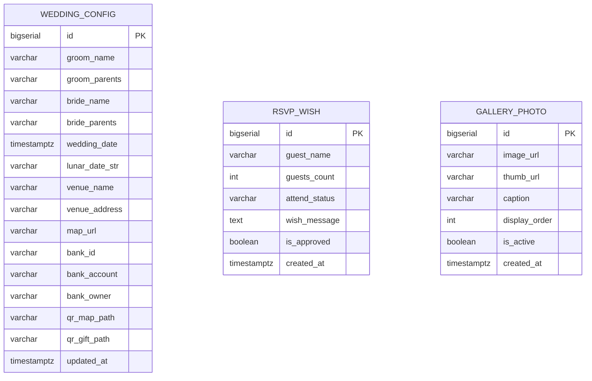

# Tài liệu Cơ sở dữ liệu & Quản lý phiên bản Flyway (Database Documentation)

## 1. Quản lý phiên bản bằng Flyway

Dự án sử dụng **Flyway** để quản lý lịch sử thay đổi cấu trúc cơ sở dữ liệu (Schema Migration). Toàn bộ các tệp SQL được đặt tại:

- `backend/src/main/resources/db/migration/`

Quy ước đặt tên file chuẩn của Flyway:
- `V<Phiên_bản>__<Mô_tả_ngắn>.sql` (lưu ý có **2 dấu gạch dưới** `__`).
- Ví dụ:
  - `V1__init_wedding_schema.sql`: Khởi tạo các bảng dữ liệu chính (`wedding_config`, `rsvp_wish`, `gallery_photo`).
  - `V2__seed_initial_data.sql`: Nạp dữ liệu mẫu ban đầu cho thiệp cưới Hồng Sơn & Tố Hạ.

### Cấu hình gợi ý trong `application.yml` (Spring Boot)
```yaml
spring:
  datasource:
    url: jdbc:postgresql://localhost:5432/wedding_db
    username: postgres
    password: secret
  flyway:
    enabled: true
    locations: classpath:db/migration
    baseline-on-migrate: true
```

---

## 2. Sơ đồ Thực thể - Liên kết (ERD)



---

## 3. Chi tiết các bảng dữ liệu

### 3.1. Bảng `wedding_config`
Lưu trữ thông tin cấu hình chung của thiệp mời cưới (tương ứng với `frontend/js/config.js`).

| Cột | Kiểu dữ liệu | Ràng buộc | Mô tả |
| :--- | :--- | :--- | :--- |
| `id` | `BIGSERIAL` | `PRIMARY KEY` | Khóa chính tự tăng |
| `groom_name` | `VARCHAR(120)` | `NOT NULL` | Họ tên chú rể |
| `groom_parents` | `VARCHAR(255)` | NULL | Thông tin phụ huynh nhà trai |
| `bride_name` | `VARCHAR(120)` | `NOT NULL` | Họ tên cô dâu |
| `bride_parents` | `VARCHAR(255)` | NULL | Thông tin phụ huynh nhà gái |
| `wedding_date` | `TIMESTAMPTZ` | `NOT NULL` | Thời điểm diễn ra hôn lễ (dùng cho đếm ngược) |
| `lunar_date_str` | `VARCHAR(100)` | NULL | Ngày âm lịch hiển thị trên thiệp |
| `venue_name` | `VARCHAR(200)` | `NOT NULL` | Tên trung tâm tiệc cưới |
| `venue_address` | `VARCHAR(300)` | `NOT NULL` | Địa chỉ chi tiết |
| `map_url` | `VARCHAR(500)` | NULL | Đường dẫn Google Maps |
| `bank_id` | `VARCHAR(30)` | NULL | Mã ngân hàng VietQR (VD: `VCB`) |
| `bank_account` | `VARCHAR(50)` | NULL | Số tài khoản nhận mừng cưới |
| `bank_owner` | `VARCHAR(120)` | NULL | Tên chủ tài khoản |
| `qr_map_path` | `VARCHAR(255)` | DEFAULT `'assets/qr/qr-map.svg'` | Đường dẫn ảnh QR bản đồ |
| `qr_gift_path` | `VARCHAR(255)` | DEFAULT `'assets/qr/qr-gift.svg'` | Đường dẫn ảnh QR mừng cưới |
| `updated_at` | `TIMESTAMPTZ` | `NOT NULL` | Thời gian cập nhật gần nhất |

### 3.2. Bảng `rsvp_wish`
Lưu trữ thông tin khách mời xác nhận tham dự và lời chúc gửi đến cô dâu chú rể (tương ứng với `frontend/js/rsvp.js`).

| Cột | Kiểu dữ liệu | Ràng buộc | Mô tả |
| :--- | :--- | :--- | :--- |
| `id` | `BIGSERIAL` | `PRIMARY KEY` | Khóa chính tự tăng |
| `guest_name` | `VARCHAR(120)` | `NOT NULL` | Tên khách mời |
| `guests_count` | `INT` | `1..20`, `DEFAULT 1` | Số lượng người tham dự |
| `attend_status` | `VARCHAR(10)` | `'yes'` hoặc `'no'` | Trạng thái tham dự |
| `wish_message` | `TEXT` | NULL | Nội dung lời chúc |
| `is_approved` | `BOOLEAN` | `DEFAULT TRUE` | Cho phép hiển thị lời chúc lên thiệp |
| `created_at` | `TIMESTAMPTZ` | `NOT NULL` | Thời gian gửi phản hồi |

### 3.3. Bảng `gallery_photo`
Lưu danh sách hình ảnh trong album cưới (tương ứng với `frontend/js/gallery.js`).

| Cột | Kiểu dữ liệu | Ràng buộc | Mô tả |
| :--- | :--- | :--- | :--- |
| `id` | `BIGSERIAL` | `PRIMARY KEY` | Khóa chính tự tăng |
| `image_url` | `VARCHAR(500)` | `NOT NULL` | Đường dẫn ảnh kích thước đầy đủ (hiển thị trong Lightbox) |
| `thumb_url` | `VARCHAR(500)` | NULL | Đường dẫn ảnh thu nhỏ (hiển thị ngoài lưới Album) |
| `caption` | `VARCHAR(255)` | NULL | Chú thích bức ảnh |
| `display_order` | `INT` | `DEFAULT 0` | Thứ tự sắp xếp ảnh |
| `is_active` | `BOOLEAN` | `DEFAULT TRUE` | Ẩn/hiện ảnh trong album |
| `created_at` | `TIMESTAMPTZ` | `NOT NULL` | Thời gian tạo |
